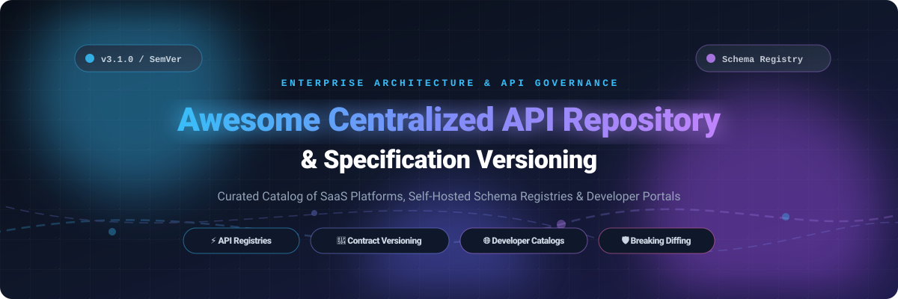

# Awesome Centralized API Repository & Versioning 🌐 📚

<p align="center">
  
</p>

<p align="center">
  <a href="https://github.com/ishandutta2007/Awesome-Awesome-Awesome"></a><a href="https://discord.gg/jc4xtF58Ve"></a>
  <a href="https://github.com/ishandutta2007/Awesome-Centralized-API-Repository-Versioning/stargazers"></a>
  <a href="https://github.com/ishandutta2007/Awesome-Centralized-API-Repository-Versioning/network/members"></a>
  <a href="https://github.com/ishandutta2007"></a>
</p>

---

## 🎯 Top Centralized API Repository & Versioning Ecosystem

> **Curated Directory of SaaS Platforms & Open-Source Projects for API Artifact Management, Schema Versioning, Breaking Change Detection & Developer Catalog Discovery.**  
> *Last updated: March 2026*

Modern microservice architectures, federated data graphs, and multi-team engineering organizations require a single source of truth for API contracts. This curated resource tracks leading **SaaS platforms** and **open-source solutions** that power centralized API registries, specification versioning (OpenAPI, AsyncAPI, GraphQL, Protobuf, Avro), automated breaking-change detection, and enterprise API catalogs.

Whether you are standardizing API governance with Git-native workflows, deploying an internal developer portal (IDP), or eliminating breaking schema changes across distributed teams, explore battle-tested tooling below.

---

## 📑 Table of Contents
- [📊 Sector Overview & Market Dynamics](#-sector-overview--market-dynamics)
- [☁️ SaaS & Hosted Platforms](#️-saas--hosted-platforms)
- [💻 Open-Source GitHub Projects](#-open-source-github-projects)
- [🛠️ Architecture & Best Practices](#️-architecture--best-practices)
- [📈 Star History](#-star-history)
- [💖 Support](#-support)
- [🤝 How to Contribute](#-how-to-contribute)
- [⚠️ Disclaimer](#️-disclaimer)

---

## 📊 Sector Overview & Market Dynamics

The global API management and developer portal sector is valued between **$8.5 billion and $10.5 billion in 2026**, expanding rapidly at a **18%–22% CAGR** toward an estimated $35+ billion by 2032. 

The market exhibits **moderate fragmentation**: foundational version control and Git-level artifact storage are dominated by hyperscalers and developer cloud giants (Microsoft/GitHub, AWS, GitLab, Atlassian), while dedicated API contract registries, schema governance engines, and internal developer catalogs represent an active, competitive frontier contested by specialized platforms (Postman, SmartBear/SwaggerHub, Redocly, Roadie) and high-traction open-source ecosystems (Backstage, Buf, Scalar).

---

## ☁️ SaaS & Hosted Platforms

The following SaaS platforms provide centralized hosting, catalog discovery, contract validation, and lifecycle versioning for APIs and schemas. Sorted descending by company size (valuation / market capitalization / revenue tier).

| SaaS Platform | Company Scale (Valuation / Revenue) | Starting Price (Paid Tier) | Free Tier Limits / Trial Limits | Key Capabilities & Artifact Management |
| :--- | :--- | :--- | :--- | :--- |
| **[Azure Repos](https://azure.microsoft.com/en-us/products/devops/repos/)** (Microsoft) | ~$3.1 Trillion market cap (Microsoft) | $6.00 / user / month (Basic Plan) | **Free forever for first 5 users**; includes unlimited private Git repos, 2 GiB free Azure Artifacts storage, and 1,800 free CI/CD build minutes/month | Git-based API contract versioning, PR branch policies, file history comparison, and seamless Azure DevOps pipeline validation. |
| **[AWS CodeCommit](https://aws.amazon.com/codecommit/)** (Amazon AWS) | ~$2.2 Trillion market cap (Amazon) | $1.00 / additional active user / month | **Free forever for first 5 active users/month**; includes 50 GB storage/month, 10,000 Git requests/month, and unlimited repos *(for existing AWS accounts)* | Fully managed Git repository with IAM authorization, encryption at rest, branch protection, and automated code review pipelines for specs. |
| **[GitHub Enterprise](https://github.com/enterprise)** (Microsoft) | ~$100 Billion+ implied valuation / $4B+ ARR | $21.00 / user / month (Enterprise Cloud) | **Free forever plan available** (Free tier covers unlimited public/private repos, 2,000 Actions minutes/month, 500 MB Packages storage; 30-day free trial for Enterprise) | Enterprise-grade Git repository management, version tagging, OpenAPI automation, Pull Request schema linting, and GitHub Enterprise Server. |
| **[Bitbucket](https://bitbucket.org/)** (Atlassian) | ~$45 Billion market cap (Atlassian) | $3.00 / user / month (Standard Plan) | **Free forever up to 5 users**; includes unlimited private repositories, 1 GB Git Large File Storage (LFS), and 50 build minutes/month | Branch permission controls, integrated Jira workflows, automated spec linting via Bitbucket Pipelines, and semantic release tagging. |
| **[GitLab](https://about.gitlab.com/)** | ~$8.5 Billion market cap / $700M+ ARR | $29.00 / user / month (Premium Plan) | **Free forever for 1 user / namespace**; includes 5 GB storage, 10 GB transfer/month, 400 compute minutes/month, and 30-day Ultimate free trial | End-to-end DevSecOps platform with Git repository versioning, protected branches, merge request governance, and CI/CD pipelines for schema diffing. |
| **[Postman API Repository](https://www.postman.com/product/api-repository/)** | ~$5.6 Billion valuation (Series D) | $9.00 / user / month (Solo, billed annually) | **Free forever for 1 user**; includes 10,000 Postman API calls/month, 100 AI credits, 5 integrations, and unlimited collection runs / mock servers | Centralized repository for all API specs and collections, Private API Network catalog, version tags, changelog tracking, and snapshot rollbacks. |
| **[SwaggerHub](https://swagger.io/tools/swaggerhub/)** (SmartBear) | ~$2.5 Billion valuation / $300M+ revenue | $19.00 / user / month (Individual Plan) | **Free plan for solo public specs** (basic editor); **14-day free trial** with full access to Team Plan features and mock servers | Central source of truth for OpenAPI & AsyncAPI specifications, reusable domain libraries, team workspaces, automated mocking, and style rule enforcement. |
| **[Stoplight](https://stoplight.io/)** (SmartBear) | ~$2.5 Billion valuation (SmartBear parent) | $44.00 / month (Basic Plan, 3 users included) | **Free forever for 1 user and 1 project**; includes visual OpenAPI/JSON Schema designer, interactive docs, and mock servers | Collaborative API design workspace with multi-branch Git synchronization, automated changelogs, dependency mapping, and Spectral style governance. |
| **[Redocly Workspaces](https://redocly.com/)** | ~$50 Million - $100 Million valuation tier | $249.00 / month (Pro Plan, billed annually) | **30-day full-featured free trial**; unlimited team seats, up to 3 projects, custom domains, interactive API docs, and mock servers (no credit card required) | Developer portal and API registry with Git branch-to-version mappings, multi-version spec hosting, role-based access, and automated linting. |
| **[Roadie Backstage](https://roadie.io/)** | ~$20 Million - $40 Million valuation tier | $24.00 / developer / month (Teams Plan) | **30-day free trial**; full access to hosted Backstage catalog, unlimited catalog entities, core integrations, and managed infrastructure | Fully managed SaaS implementation of Spotify's Backstage; centralized software catalog for microservices, OpenAPI definitions, and TechDocs. |

---

## 💻 Open-Source GitHub Projects

Explore the leading open-source repositories powering developer portals, schema registries, breaking change detectors, and contract linters. Sorted descending by GitHub Stars_Count.

- **[Backstage](https://github.com/backstage/backstage)** [](https://github.com/backstage/backstage/stargazers)  
  CNCF Incubation framework created by Spotify for building developer portals with a centralized software catalog (microservices, libraries, APIs, data pipelines); includes Software Templates, TechDocs ("docs like code"), and an extensive plugin ecosystem for enterprise API discovery and governance.

- **[Scalar](https://github.com/scalar/scalar)** [](https://github.com/scalar/scalar/stargazers)  
  Modern open-source developer platform and API reference tool with first-class OpenAPI/Swagger support, interactive API clients, offline capabilities, and dynamic documentation generation.

- **[Buf](https://github.com/bufbuild/buf)** [](https://github.com/bufbuild/buf/stargazers)  
  Comprehensive tooling for Protocol Buffers including schema registries, backward-compatibility linting, breaking change detection, and centralized module repository management.

- **[APIs-guru/openapi-directory](https://github.com/APIs-guru/openapi-directory)** [](https://github.com/APIs-guru/openapi-directory/stargazers)  
  Community-maintained Wikipedia for Web APIs containing REST definitions in OpenAPI 2.0/3.x format, serving as a public reference catalog for API discovery, version tracking, and schema definitions.

- **[Spectral](https://github.com/stoplightio/spectral)** [](https://github.com/stoplightio/spectral/stargazers)  
  Flexible JSON/YAML linter for enforcing API style guides and governance across OpenAPI, AsyncAPI, and JSON Schema specifications within CI/CD and Git-based versioning workflows.

- **[Confluent Schema Registry](https://github.com/confluentinc/schema-registry)** [](https://github.com/confluentinc/schema-registry/stargazers)  
  Centralized serving layer for schemas, supporting Apache Avro, JSON Schema, and Protobuf with RESTful interfaces for managing versioned schemas, compatibility rules, and Kafka event validation.

- **[GraphQL Inspector](https://github.com/graphql-hive/graphql-inspector)** [](https://github.com/graphql-hive/graphql-inspector/stargazers)  
  Tooling suite for GraphQL schema validation, breaking change detection, schema diffing, and version tracking across Git workflows and deployments.

- **[Optic](https://github.com/opticdev/optic)** [](https://github.com/opticdev/optic/stargazers)  
  Git-native API governance tool that tracks OpenAPI specification changes, detects breaking changes in PRs, and automatically enforces API design standards.

- **[oasdiff](https://github.com/oasdiff/oasdiff)** [](https://github.com/oasdiff/oasdiff/stargazers)  
  High-performance OpenAPI 3.0/3.1 diff engine and breaking change detector for verifying API version compatibility and specification evolution in CI/CD pipelines.

- **[vacuum](https://github.com/daveshanley/vacuum)** [](https://github.com/daveshanley/vacuum/stargazers)  
  Ultra-fast OpenAPI, Arazzo, AsyncAPI & JSON Schema linter and governance toolkit written in Go, fully compatible with Spectral rulesets.

- **[OpenAPI-Diff](https://github.com/OpenAPITools/openapi-diff)** [](https://github.com/OpenAPITools/openapi-diff/stargazers)  
  Utility for comparing two OpenAPI specifications to identify differences and backward-incompatible changes between API versions.

- **[Apicurio Registry](https://github.com/Apicurio/apicurio-registry)** [](https://github.com/Apicurio/apicurio-registry/stargazers)  
  Production-grade open-source registry for API designs and schemas (OpenAPI, AsyncAPI, Avro, Protobuf, JSON Schema) with compatibility checking, content versioning, and multiple storage backends.

- **[Stencil](https://github.com/raystack/stencil)** [](https://github.com/raystack/stencil/stargazers)  
  Dynamic schema registry for managing and validating Protobuf schemas, providing runtime validation, backward compatibility checks, and schema evolution tracking.

- **[Apinf Platform](https://github.com/apinf/platform)** [](https://github.com/apinf/platform/stargazers)  
  Open-source API management platform with multi-proxy and protocol support, offering an API catalog and developer portal capabilities.

- **[api-versioner](https://github.com/SuperInstance/api-versioner)** [](https://github.com/SuperInstance/api-versioner/stargazers)  
  Pure Python library for semantic version parsing, deprecation tracking with sunset dates, version-aware routing, and auto-generated migration guides.

### 📦 Ecosystem Libraries & Utilities

- **[@docsmyth/hub](https://www.npmjs.com/package/@docsmyth/hub)** — Centralized HTTP service for storing and serving API contracts with immutability guarantees (published versions cannot be overwritten), SHA-256 integrity hashing, and filesystem storage.
- **Git-Based OpenAPI CI/CD** — Pair Spectral or Vacuum with Git repository branching and tagging for automated spec validation and changelog tracking.
- **Enterprise Plugin Portals** — Modular API portals built with Backstage catalog plugins for service and spec discovery.

---

## 🛠️ Architecture & Best Practices

Building an enterprise-ready API catalog and versioning layer typically follows a three-tier architecture:

```
+-------------------------------------------------------------------+
|                    Developer Experience / Catalog                 |
|   (Backstage Software Catalog / Scalar / Redocly Developer Hub)   |
+-------------------------------------------------------------------+
                                  │
                                  ▼
+-------------------------------------------------------------------+
|                    Central Registry & Schema Store                |
|      (Apicurio Registry / Confluent Schema Registry / Buf BSR)    |
+-------------------------------------------------------------------+
                                  │
                                  ▼
+-------------------------------------------------------------------+
|                   CI/CD Linting & Breaking Change Diff            |
|       (Spectral / Vacuum / oasdiff / Optic via GitHub Actions)    |
+-------------------------------------------------------------------+
```

1. **Treat Specifications as Code**: Store your OpenAPI, AsyncAPI, or Protobuf specifications alongside your service code or in a dedicated centralized schema repository under Git version control.
2. **Automate Breaking Change Detection**: Block PR merges using `oasdiff` or `optic` when backward-incompatible modifications are detected without an appropriate major version bump.
3. **Decouple Discovery from Runtime**: Centralize catalog metadata so internal and external developers can discover existing endpoints without needing production infrastructure access.

---

## 📈 Star History

[](https://www.star-history.com/#ishandutta2007/Awesome-Centralized-API-Repository-Versioning&type=date&legend=top-left)

---

## 💖 Support

Thank you for exploring and utilizing this curated ecosystem! If you find this project valuable, please consider supporting its ongoing maintenance and growth:

- ⭐ **Star the repository** on GitHub to increase visibility.
- 🍴 **Fork the repo** to contribute new tools, libraries, or architectural patterns.
- 📢 **Share with your colleagues**, platform teams, and developer communities.
- ☕ **Sponsor the creator** or buy a coffee via the [GitHub Sponsor Dashboard](https://github.com/sponsors/ishandutta2007).

Your backing ensures this guide remains continuously updated with the latest tools, standards, and industry benchmarks!

---

## 🤝 How to Contribute

We welcome community contributions! To add a new platform, library, or update an existing entry:

1. 🍴 **Fork the repository**.
2. 📝 **Edit `README.md`**:
   - For SaaS products: include official product link, valuation/market tier, verified starting price, and exact free tier/trial limits.
   - For open-source tools: include GitHub link, social Stars_Badge, and accurate 1–2 sentence description.
3. 🚀 **Submit a Pull Request** with a concise description of your additions.

---

## ⚠️ Disclaimer

- This is a **community-curated** catalog — inclusion does not represent an endorsement.
- All company valuations, market capitalizations, and SaaS pricing tiers reflect publicly accessible market data and are subject to change by their respective providers.
- When hosting internal API contracts and specifications, verify access policies, encryption, and governance controls to protect sensitive internal architectures.

---

<p align="center">
  <b>Built with ❤️ for API architects, platform engineers, and developer experience teams.</b><br/>
  <sub>Let's build reliable, discoverable, and forward-compatible API infrastructure.</sub>
</p>
